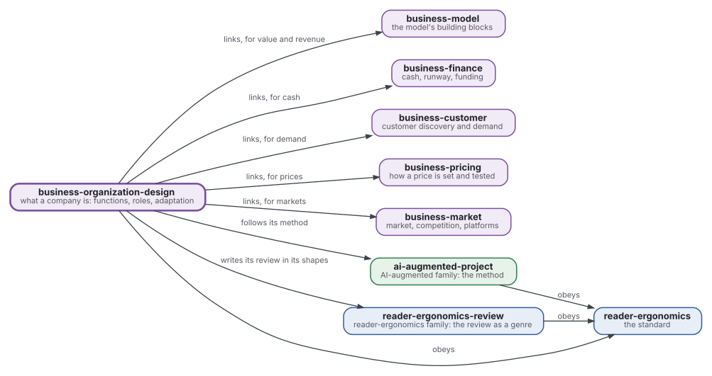
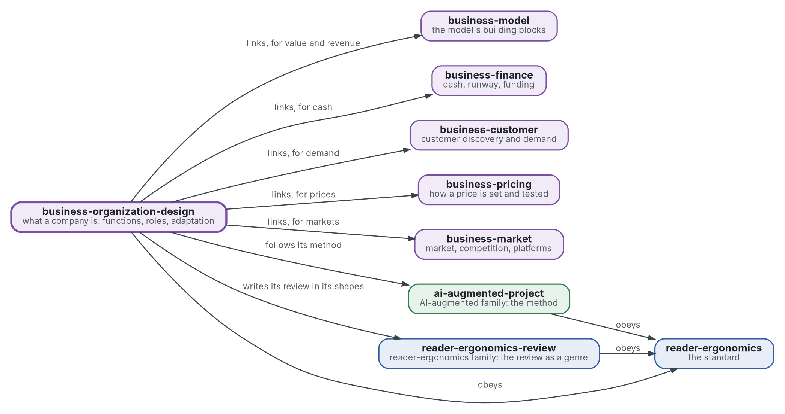

# Organisation : ce qu'est une entreprise

[](https://github.com/Tewf/business-organization-design/actions/workflows/checks.yml)
[](https://tewf.github.io/business-organization-design/)

Ce qu'est une entreprise en tant qu'organisation. Il tient les **fonctions** qu'une entreprise doit remplir (économiques, juridiques, techniques, humaines) et les rôles et la structure qui les remplissent. Il demande comment écrire une entreprise comme un système qui traite l'information, et comment elle s'adapte.

Cette page en anglais : [README.md](README.md). Les deux versions suivent le même état.

> **État (2026-11-12) :** la première revue est écrite, en première passe de 64 sources, et se termine sur une
> référence nommée, B1, acceptée par le mainteneur comme base du travail suivant. Le dépôt prend le nom du domaine,
> organization design ([fiche 0004](decisions/0004-rename-to-business-organization-design.md)). La première forme bâtie sur B1, la
> description d'une organisation avec son contrôle, suit ([fiche 0003](decisions/0003-describe-an-organisation-as-b1s-table.md)). Ce n'est ni une norme officielle, ni une
> étude relue par des pairs, ni un résultat nouveau.
>
> **Comment il est fait :** avec Claude, un assistant IA d'Anthropic, sous la direction du mainteneur, comme
> reader-ergonomics. Les corrections sont bienvenues sous forme d'issues.

## Où il se place



<details>
<summary>Source Graphviz</summary>



</details>

- **Il renvoie à cinq membres de la famille** pour ce qu'ils tiennent et que lui ne tient pas. Ce sont les briques du modèle ([business-model](https://github.com/Tewf/business-model)), la trésorerie et le financement ([business-finance](https://github.com/Tewf/business-finance)), la demande ([business-customer](https://github.com/Tewf/business-customer)), les prix ([business-pricing](https://github.com/Tewf/business-pricing)) et les marchés ([business-market](https://github.com/Tewf/business-market)). Il n'en copie aucun.
- **Sa méthode est celle d'[ai-augmented-project](https://github.com/Tewf/ai-augmented-project)** : périmètre, revue, référence et plan, et les registres des décisions et des valeurs provisoires.
- **Il écrit sa revue dans les formes de [reader-ergonomics-review](https://github.com/Tewf/reader-ergonomics-review)**, la revue comme genre.
- **Il obéit à [reader-ergonomics](https://github.com/Tewf/reader-ergonomics/blob/65e42472e2d4cbfd994c2a86e95a47e5dc7301ca/standard.md)** (v1.24.2) et lance ses vérifications en CI.
- **Il ne renvoie que vers le bas.** La carte de la famille est [business](https://github.com/Tewf/business). Une entreprise n'y paraît qu'en exemple, jamais en sujet : une jeune entreprise qui personnalise un produit.

## Périmètre

| | Quoi | Pourquoi |
|---|---|---|
| dedans | les besoins d'une entreprise, en liste qu'un programme peut compter : les fonctions ou processus qu'elle doit faire tourner, économiques, juridiques, techniques et humains | un besoin absent d'une liste ne peut pas être vérifié comme rempli |
| dedans | la frontière de la firme : pourquoi un travail est fait dedans et un autre acheté | elle dit pourquoi une entreprise existe, donc ce qu'elle doit tenir |
| dedans | les rôles et l'architecture humaine : division du travail, coordination, structure, gouvernance et droits de décision | qui décide quoi est la part d'une entreprise qu'un outil ne fournit pas |
| dedans | l'organisation comme système qui traite l'information : qui sait quoi, qui informe qui, qui décide, écrit pour qu'un programme le lise | un plan écrit ainsi peut être comparé à un autre et vérifié |
| dedans | l'adaptation et l'apprentissage : comment une organisation cherche, exploite ce qu'elle sait et change son propre plan | un plan qui ne peut pas changer n'est juste qu'une fois |
| plus tard | une forme pour la description d'une organisation, avec un programme qui la lit | une forme suit la référence de la revue, pas l'inverse |
| dehors | les briques du modèle d'affaires : valeur, canaux, revenus, coûts | [business-model](https://github.com/Tewf/business-model) |
| dehors | la trésorerie, l'autonomie financière et le financement | [business-finance](https://github.com/Tewf/business-finance) |
| dehors | la demande et ce que les clients achèteront | [business-customer](https://github.com/Tewf/business-customer) |
| dehors | la fixation d'un prix | [business-pricing](https://github.com/Tewf/business-pricing) |
| dehors | la taille du marché et la concurrence | [business-market](https://github.com/Tewf/business-market) |
| dehors | les formes de société et les formalités d'un pays | elles relèvent d'un juriste et changent selon le pays ; les fonctions juridiques dont toute entreprise a besoin restent dedans |

## Ce que la revue a trouvé

- **Le domaine coupe le sujet en deux.** Le design organisationnel et la théorie des organisations étudient comment le travail est divisé et coordonné. La théorie de la firme et l'économie des organisations étudient pourquoi une firme existe et qui décide ([cadrage](evidence/organisation-design/frame.md)). Le nom est gardé.
- **Ce que fait une entreprise est listé par la pratique, pas par la théorie.** La liste la plus adoptée est une classification de processus commune aux secteurs (Cragg 2007, secondaire, pour 66 petites entreprises). Un recueil range plus de 5000 activités par abstraction et par dépendance (Malone 1999). Aucune liste testée pour sa complétude n'a été trouvée.
- **Quatre problèmes définissent une organisation.** La division des tâches, leur attribution, la récompense et l'information sont dites nécessaires et suffisantes (Puranam 2014, p. 165-166).
- **La structure la plus connue a échoué à son test.** Les cinq types idéaux de Mintzberg n'ont pas prédit l'efficacité. Ceux de Miles et Snow en ont prédit 24 % de la variance (Doty 1993, secondaire).
- **Les droits de décision se séparent, et la délégation est mesurée.** La délégation va avec une forte valeur de l'adaptation locale, la centralisation avec une forte valeur de la coordination (McElheran 2014, secondaire).
- **L'adaptation est surtout simulée.** L'exploitation évince l'exploration (March 1991), la forme de départ persiste (Levinthal 1997), et une suite de structures bat une structure fixe (Siggelkow 2005), tous dans des modèles.

## Les questions, avec leur réponse

| Question | Réponse | Niveau |
|---|---|---|
| Besoins | une classification de processus de la pratique, plus la personne morale ; aucune liste montrée complète | convention |
| Rôles | quatre problèmes universels ; propriété, contrôle et droits de décision séparés ; la délégation suit la valeur de l'adaptation | convention ; délégation mesurée |
| Représentation | des processeurs limités, mesurés par leur nombre et leur délai, ou des modèles de processus dans une notation standard | mesuré, dans un modèle |
| Adaptation | une recherche sur un paysage accidenté, où l'exploitation évince l'exploration | mesuré, par simulation |

Les sources et les questions ouvertes sont dans le [positionnement](evidence/organisation-design/position.md).

## La référence

**B1** est une liste de processus où les quatre problèmes d'organisation reçoivent une réponse pour chaque processus ([référence](evidence/organisation-design/baseline.md)).

- Ses lignes sont les catégories de la classification de processus commune aux secteurs, plus la personne morale ; ses colonnes sont les tâches, qui, la récompense, l'information, qui décide et qui contrôle.
- Elle est comparée à un organigramme de la même jeune entreprise, par les cases vides qu'elle trouve.

## Vérifier

```sh
git clone https://github.com/Tewf/reader-ergonomics
python3 reader-ergonomics/checks/run.py chemin/vers/ce/depot
```

La CI lance les mêmes vérifications à chaque push, et un passage échoue sur toute erreur
([checks.yml](https://github.com/Tewf/business-organization-design/blob/master/.github/workflows/checks.yml)). Chaque push sur
master construit aussi le site, [tewf.github.io/business-organization-design](https://tewf.github.io/business-organization-design/)
([pages.yml](https://github.com/Tewf/business-organization-design/blob/master/.github/workflows/pages.yml)).

## Contenu

| Partie | Résumé |
|---|---|
| [evidence](evidence/) | la première revue, en première passe de 64 sources, finie sur la référence B1, et la bibliographie |
| [shapes](shapes/) | la description d'une organisation, la table de B1 pour une organisation, avec un exemple fictif et le contrôle qui la lit |
| [decisions](decisions/) | une fiche par choix qui façonne ce dépôt, chacune ouvrant sur la décision en une phrase |

## Licence

Code sous [Apache License 2.0](LICENSE) ; prose sous [CC BY 4.0](LICENSES/CC-BY-4.0.txt). Réutilisez-le comme vous
voulez, en citant ce dépôt ; [CITATION.cff](CITATION.cff) donne une citation si besoin.
