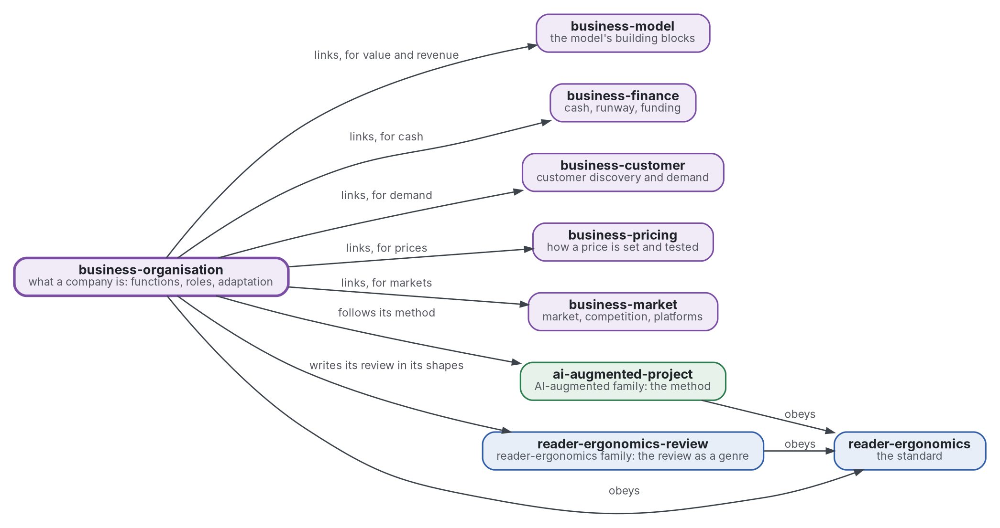

# Organisation: what a company is

[](https://github.com/Tewf/business-organisation/actions/workflows/checks.yml)
[](https://tewf.github.io/business-organisation/)

What a company is, as an organisation. It holds the **functions** a company must perform (economic, legal, technical, human) and the roles and structure that perform them. It asks how a company is written down as an information-processing system, and how it adapts.

This page in French: [README.fr.md](README.fr.md).

> **Status (2026-11-11):** set up; nothing is written yet beyond the scope. The first job is a literature review, not
> started. The name is provisional until that review's first step says what the field calls this. It is not an
> official standard, not a peer-reviewed study and not a new result.
>
> **How it is made:** with Claude, an AI assistant by Anthropic, under the maintainer's direction, the way
> reader-ergonomics was made. Corrections are welcome as issues.

## Where it sits


<details>
<summary>Graphviz source</summary>



</details>

- **It links five members of the family** for what they hold and it does not: the model's building blocks ([business-model](https://github.com/Tewf/business-model)), cash and funding ([business-finance](https://github.com/Tewf/business-finance)), demand ([business-customer](https://github.com/Tewf/business-customer)), prices ([business-pricing](https://github.com/Tewf/business-pricing)) and markets ([business-market](https://github.com/Tewf/business-market)). It copies none of them.
- **Its method is [ai-augmented-project](https://github.com/Tewf/ai-augmented-project)'s**: scope, review, baseline and plan, and the registers of decisions and of provisional values. It does not depend on that repository's other parts.
- **It writes its review in the shapes of [reader-ergonomics-review](https://github.com/Tewf/reader-ergonomics-review)**, the review as a genre; the shapes are that repository's.
- **It obeys [reader-ergonomics](https://github.com/Tewf/reader-ergonomics/blob/65e42472e2d4cbfd994c2a86e95a47e5dc7301ca/standard.md)** (v1.24.2) and runs its checks in CI.
- **It links down only.** The family's map is [business](https://github.com/Tewf/business). A venture appears here as an example, never as the subject: a venture that personalises a product.

## Scope

| | What | Why |
|---|---|---|
| in | the needs of a company, as a list a program can count: the functions or processes it must run, economic, legal, technical and human | a need that is not on a list cannot be checked as met |
| in | the boundary of the firm: why some work is done inside and some is bought | it says why a company exists at all, and so what it must hold |
| in | roles and human architecture: the division of labour, coordination, structure, governance and decision rights | who decides what is the part of a company a tool does not supply |
| in | the organisation as an information-processing system: who knows what, who tells whom, who decides, written so a program can read it | a design written that way can be compared with another and checked |
| in | adaptation and learning: how an organisation searches, exploits what it knows and changes its own design | a design that cannot change is right only once |
| later | a shape for the description of one organisation, with a check that reads it | a shape follows the review's baseline, not the reverse |
| out | the business model's building blocks: value, channels, revenue, costs | [business-model](https://github.com/Tewf/business-model) |
| out | cash, runway and funding | [business-finance](https://github.com/Tewf/business-finance) |
| out | demand and what customers will buy | [business-customer](https://github.com/Tewf/business-customer) |
| out | how a price is set | [business-pricing](https://github.com/Tewf/business-pricing) |
| out | market size and competition | [business-market](https://github.com/Tewf/business-market) |
| out | the company forms and filings of one country | they are a lawyer's to read and change by jurisdiction; the legal functions every company needs stay in |

## The first job: a literature review

Not started. It follows the order of a thesis review, and it is finished when it can name the baseline.

1. **Frame:** the problem in one sentence, and what each field calls it. Leads to verify: theory of the firm, organisation design, organisation theory, the Carnegie school, team theory, coordination theory. The repository may be renamed then.
2. **Review:** each name, searched by its academic name, its acronym and its author; surveys first.
   - the leads Coase 1937, March and Simon 1958, Cyert and March 1963, Galbraith 1974, Mintzberg 1979, Marschak and Radner 1972, Radner 1993, March 1991 and Levinthal 1997, screened before they enter the pool;
   - process frameworks used in practice, such as a cross-industry process classification, as grey sources scored on Garousi 2019's criteria.
3. **State of the art, and the case against.**
4. **Position:** what this repository asks that the field does not already answer.
5. **Baseline:** the description of a company the field already uses, named, that later work is compared against.

## Questions the review must answer

- **Needs.** What must a company do, as an enumerable list of functions or processes?
- **Roles.** What roles and what human architecture perform them: structure, governance, who decides what?
- **Representation.** How is an organisation written as an algorithm or an information-processing system?
- **Adaptation.** How does an organisation adapt and learn, and change its own design?

## Check it

```sh
git clone https://github.com/Tewf/reader-ergonomics
python3 reader-ergonomics/checks/run.py path/to/this/repository
```

CI runs the same checks on every push, and a run fails on any error
([checks.yml](https://github.com/Tewf/business-organisation/blob/master/.github/workflows/checks.yml)). Every push to
master also renders the site, [tewf.github.io/business-organisation](https://tewf.github.io/business-organisation/)
([pages.yml](https://github.com/Tewf/business-organisation/blob/master/.github/workflows/pages.yml)).

## Contents

| Part | Summary |
|---|---|
| [decisions](decisions/) | one record per choice that shapes this repository, each opening with the decision in one sentence |

## Licence

Code under the [Apache License 2.0](LICENSE); prose under [CC BY 4.0](LICENSES/CC-BY-4.0.txt). Reuse it as you wish,
with credit to this repository; [CITATION.cff](CITATION.cff) gives a citation if you need one.
