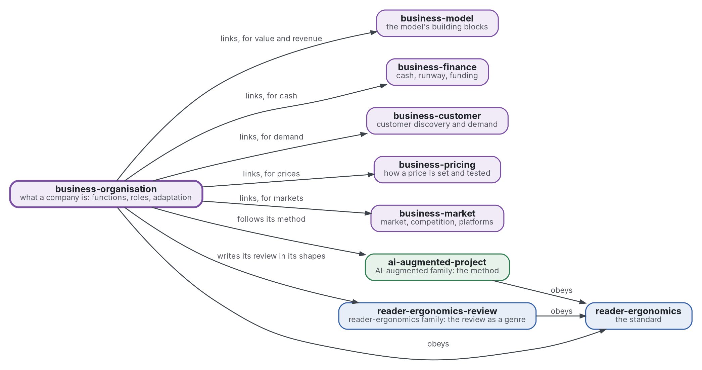

# Organisation: what a company is

[](https://github.com/Tewf/business-organisation/actions/workflows/checks.yml)
[](https://tewf.github.io/business-organisation/)

What a company is, as an organisation. It holds the **functions** a company must perform (economic, legal, technical, human) and the roles and structure that perform them. It asks how a company is written down as an information-processing system, and how it adapts.

This page in French: [README.fr.md](README.fr.md).

> **Status (2026-11-12):** the first review is written, as a first pass of 64 sources, and ends on a named baseline,
> B1. The name is kept after the frame step ([record 0002](decisions/0002-keep-the-name-and-name-the-baseline.md)).
> It is not an official standard, not a peer-reviewed study and not a new result.
>
> **How it is made:** with Claude, an AI assistant by Anthropic, under the maintainer's direction, the way
> reader-ergonomics was made. Corrections are welcome as issues.

## Where it sits


<details>
<summary>Graphviz source</summary>



</details>

- **It links five members of the family** for what they hold and it does not: the model's building blocks ([business-model](https://github.com/Tewf/business-model)), cash and funding ([business-finance](https://github.com/Tewf/business-finance)), demand ([business-customer](https://github.com/Tewf/business-customer)), prices ([business-pricing](https://github.com/Tewf/business-pricing)) and markets ([business-market](https://github.com/Tewf/business-market)). It copies none of them.
- **Its method is [ai-augmented-project](https://github.com/Tewf/ai-augmented-project)'s**: scope, review, baseline and plan, and the registers of decisions and of provisional values. It does not depend on that repository's other parts.
- **It writes its review in the shapes of [reader-ergonomics-review](https://github.com/Tewf/reader-ergonomics-review)**, the review as a genre; the shapes are that repository's.
- **It obeys [reader-ergonomics](https://github.com/Tewf/reader-ergonomics/blob/65e42472e2d4cbfd994c2a86e95a47e5dc7301ca/standard.md)** (v1.24.2) and runs its checks in CI.
- **It links down only.** The family's map is [business](https://github.com/Tewf/business). A venture appears here as an example, never as the subject: a venture that personalises a product.

## Scope

| | What | Why |
|---|---|---|
| in | the needs of a company, as a list a program can count: the functions or processes it must run, economic, legal, technical and human | a need that is not on a list cannot be checked as met |
| in | the boundary of the firm: why some work is done inside and some is bought | it says why a company exists at all, and so what it must hold |
| in | roles and human architecture: the division of labour, coordination, structure, governance and decision rights | who decides what is the part of a company a tool does not supply |
| in | the organisation as an information-processing system: who knows what, who tells whom, who decides, written so a program can read it | a design written that way can be compared with another and checked |
| in | adaptation and learning: how an organisation searches, exploits what it knows and changes its own design | a design that cannot change is right only once |
| later | a shape for the description of one organisation, with a check that reads it | a shape follows the review's baseline, not the reverse |
| out | the business model's building blocks: value, channels, revenue, costs | [business-model](https://github.com/Tewf/business-model) |
| out | cash, runway and funding | [business-finance](https://github.com/Tewf/business-finance) |
| out | demand and what customers will buy | [business-customer](https://github.com/Tewf/business-customer) |
| out | how a price is set | [business-pricing](https://github.com/Tewf/business-pricing) |
| out | market size and competition | [business-market](https://github.com/Tewf/business-market) |
| out | the company forms and filings of one country | they are a lawyer's to read and change by jurisdiction; the legal functions every company needs stay in |

## What the review found

- **The field splits the subject in two.** Organization design and organization theory study how work is divided and coordinated. The theory of the firm and organizational economics study why a firm exists and who decides ([frame](evidence/organisation-design/frame.md)). The name is kept.
- **What a company does is listed in practice, not in theory.** A cross-industry process classification is the most adopted list (used for 66 small firms, Cragg 2007, secondary). A handbook organises over 5000 business activities by abstraction and dependency (Malone 1999). No list tested for completeness was found.
- **Four problems define an organisation.** Task division, task allocation, reward and information are claimed necessary and sufficient (Puranam 2014, pp. 165-166).
- **The best-known structure failed its test.** Mintzberg's five ideal types did not predict effectiveness; Miles and Snow's types predicted 24% of its variance (Doty 1993, secondary).
- **Decision rights are separable and delegation is measured.** Delegation goes with a high value of local adaptation, centralisation with a high value of coordination (McElheran 2014, secondary).
- **Adaptation is mostly simulated.** Exploitation crowds out exploration (March 1991), the form at founding persists (Levinthal 1997), and a sequence of structures beats a fixed one (Siggelkow 2005), all in models.

## The questions, answered

| Question | Answer | Grade |
|---|---|---|
| Needs | a practice classification of processes, plus the legal person; no list shown complete | convention |
| Roles | four universal problems; ownership, control and decision rights apart; delegation follows the value of adaptation | convention; delegation measured |
| Representation | limited processors measured by their number and delay, or process models in a standard notation | measured, as a model |
| Adaptation | search on a rugged landscape, where exploitation crowds out exploration | measured, a simulation |

The sources and the open questions are in [position](evidence/organisation-design/position.md).

## The baseline

**B1** is a process list with the four problems of organizing answered for each process ([baseline](evidence/organisation-design/baseline.md)).

- Its rows are the categories of the cross-industry process classification, plus the legal person; its columns are tasks, who, reward, information, who decides and who controls.
- It is compared with an org chart of the same venture, by the empty cells it finds.

## Check it

```sh
git clone https://github.com/Tewf/reader-ergonomics
python3 reader-ergonomics/checks/run.py path/to/this/repository
```

CI runs the same checks on every push, and a run fails on any error
([checks.yml](https://github.com/Tewf/business-organisation/blob/master/.github/workflows/checks.yml)). Every push to
master also renders the site, [tewf.github.io/business-organisation](https://tewf.github.io/business-organisation/)
([pages.yml](https://github.com/Tewf/business-organisation/blob/master/.github/workflows/pages.yml)).

## Contents

| Part | Summary |
|---|---|
| [evidence](evidence/) | the first review, a first pass of 64 sources, ending on the baseline B1, and the bibliography |
| [decisions](decisions/) | one record per choice that shapes this repository, each opening with the decision in one sentence |

## Licence

Code under the [Apache License 2.0](LICENSE); prose under [CC BY 4.0](LICENSES/CC-BY-4.0.txt). Reuse it as you wish,
with credit to this repository; [CITATION.cff](CITATION.cff) gives a citation if you need one.
