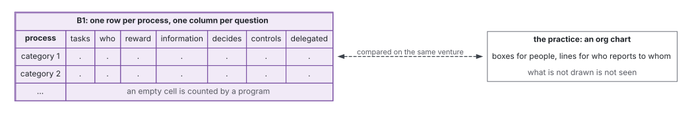
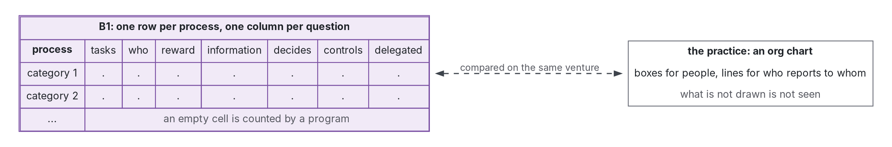

# Baseline

Step 5 of the review: the baseline the work is compared against. Evidence is in [review](review.md).

**Shape:** [baseline](https://github.com/Tewf/reader-ergonomics-review/blob/39d3b25cd822a20277ee39c37b9e0130439802f2/shapes/baseline.md)

## B1: a process list with the four problems of organizing answered for each process

Graphviz source

1. The rows are the level-1 categories of the cross-industry process classification, a practice list of what a company does; a 24-item instrument built from it was used with 66 small firms (Cragg 2007, secondary). That it is the most adopted such list is this review's label for the practice, not a count. Version 8.0, generated 25 Feb. 2026, read in its Excel file on 12 Nov. 2026 (APQC 2026 Classification; protocol, G7):
   - 1.0 Develop Vision and Strategy
   - 2.0 Develop and Manage Products and Services
   - 3.0 Market and Sell Products and Services
   - 4.0 Manage Supply Chain for Physical Products
   - 5.0 Deliver Services
   - 6.0 Manage Customer Service
   - 7.0 Develop and Manage Human Resources
   - 8.0 Manage Information Technology (IT)
   - 9.0 Manage Financial Resources
   - 10.0 Acquire, Construct, and Manage Assets
   - 11.0 Manage Enterprise Risk, Compliance, Remediation, and Resiliency
   - 12.0 Manage External Relationships
   - 13.0 Develop and Manage Business Capabilities

   The category names are APQC's; their notice is in the [bibliography](../bibliography.md), APQC 2026 Classification.
2. One row is added for the legal function the classification does not hold at level 1. It has a board and governance only lower down (9.8.1.1, 12.3, 12.4.2). The added row is the firm as a person holding assets apart from its owners (Hansmann 2000).
3. The columns are the four universal problems of organizing for that process: its tasks, who does them, how they are rewarded and what information they receive (Puranam 2014). The "who" is a role, defined apart from the person who fills it (HolacracyOne 2026 Constitution).
4. Three more columns name who decides and who controls each process, kept apart (Fama 1983), and whether the decision is delegated (McElheran 2014).
5. The table is data a program reads, so that a missing cell is counted, not noticed.
6. It is compared with the practice, an org chart of the same venture: boxes for people and lines for reporting (Mintzberg 1979 for the parts it draws).

## Compared with what the review found

| Item | In B1 | Fit |
|---|---|---|
| A list of what a firm does (Porter 1985, Malone 1999, Cragg 2007) | the rows | matches, for a practice list; its completeness is untested |
| The legal person (Hansmann 2000, Hansmann 2006) | one added row | in part: one row, not the law of any country |
| The four universal problems (Puranam 2014, Martela 2019) | four columns | matches |
| Decision rights, ownership and control apart (Fama 1983, Jensen 1976) | two columns | in part: who owns is left to business-finance |
| Delegation by the value of adaptation (McElheran 2014) | a column marks it | in part: the value is not measured |
| Coordination as the management of dependencies (Malone 1994) | none | lacks |
| Efficiency as the number of processors and the delay (Radner 1993) | none | lacks |
| Adaptation and a change of design (March 1991, Levinthal 1997, Siggelkow 2005) | none | lacks |
| Fit to a configuration (Mintzberg 1979) | none, on purpose | the five types did not predict effectiveness (Doty 1993) |

## What B1 lacks

- The dependencies between processes, which coordination theory makes the core of an organisation (Malone 1994).
- A measure of the information each process must handle and the delay of its decisions (Radner 1993, Van Zandt 1999).
- Any rule for when the design should change, though a sequence of structures can beat a fixed one (Siggelkow 2005).
- A test that the rows are complete (position, Not found).
- Evidence on young firms: the field's results come from established ones (against, a young venture).

## How it is measured

- Coverage: the share of process rows with a role in the "who" column.
- Completeness: the share of the cells of the table that are filled, four problems and two rights per row.
- Gaps found: the number of empty cells in B1 for a venture whose org chart shows no gap, on the same venture.
- A repeat: a program counts the cells of any description written as the table, and its test passes on a fixture that holds no real company.

## The review is finished

The next work, done on 12 Nov. 2026, is a shape for the description of one organisation as B1's table, with a check that counts its empty cells ([record 0003](../../decisions/0003-describe-an-organisation-as-b1s-table.md)). The baseline is named: B1.
